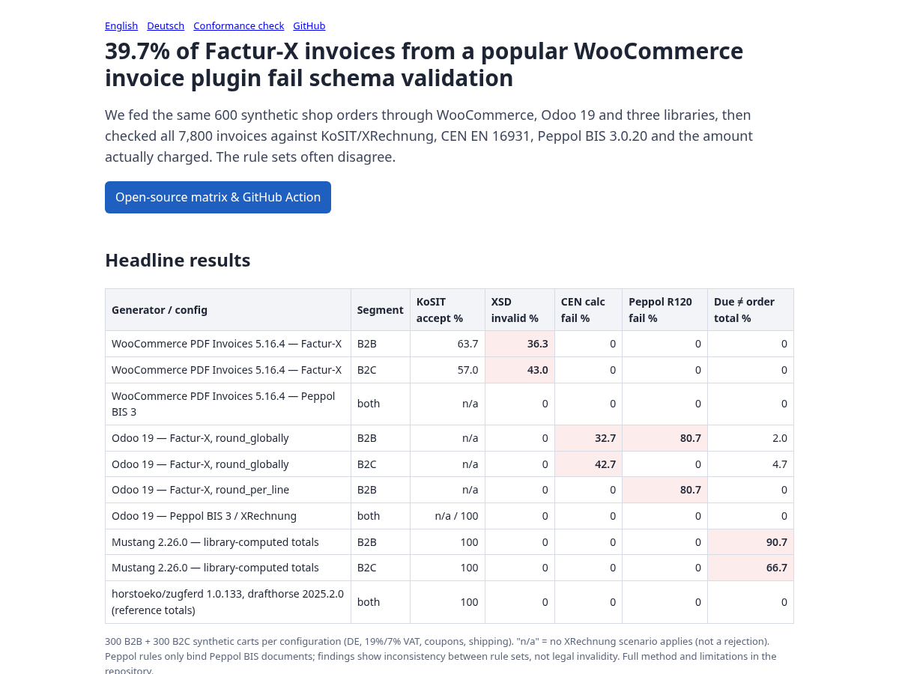

# einvoice-conformance-matrix

**Find out whether your XRechnung / ZUGFeRD / Peppol invoices actually pass KoSIT, EN 16931 and Peppol, in one CI step.**

[](LICENSE)
[](#headline-matrix-9000-invoices)
[](https://kobima6813.github.io/einvoice-conformance-matrix/)
[](https://github.com/kobima6813/einvoice-conformance-matrix/stargazers)



**Quick start:** add `- uses: kobima6813/einvoice-conformance-matrix@main` with `invoices: <dir of *.xml>` to a workflow ([details](#use-the-github-action-on-your-own-invoices)).

**Why:** the official validators disagree with each other more often than you'd expect, and an invoice that "looks fine" can still be rejected. This repo runs the same synthetic orders through real generators and checks every invoice against all rule sets at once, so you see the disagreements before your customers do. Bugs found this way were reported upstream and fixed in released versions (see [Upstream reports](#upstream-reports)).

A reproducible, cross-validator conformance matrix for EN 16931 e-invoice generators
(shop/ERP plugins and libraries), plus a GitHub Action that runs the same checks on your own
generated invoices.

The same synthetic shop orders are turned into invoices by each generator, and every invoice is checked by
several independent rule sets at once:

* **KoSIT validator 1.6.3** with the **XRechnung 3.0.2** configuration (schema + XRechnung/EN 16931 rules)
* **CEN EN 16931** validation XSLT (ConnectingEurope/eInvoicing-EN16931 @ `6e35e0a`)
* **Peppol BIS Billing 3.0.20** schematron
* exact decimal arithmetic checks, and **amount due vs. amount actually charged** for the order

All validator artefacts are downloaded at runtime from their official sources and verified by SHA-256
(`validators/pins.txt`); nothing third-party is vendored in this repository.

> The corpus is **synthetic**: 600 generated tax-inclusive carts. No real orders, customers or personal data
> are included. All names, addresses, VAT IDs and IBANs in the invoices are placeholder/test values.

## Headline matrix (9,000 invoices)

300 B2B + 300 B2C carts per generator configuration (German VAT 19 % / 7 %, percentage coupons, shipping).

| generator / config | seg | KoSIT accept % | no KoSIT scenario % | XSD invalid % | CEN calc fail % | Peppol R120 fail % | due ≠ order total % |
|---|---|---|---|---|---|---|---|
| WooCommerce PDF Invoices 5.16.4, Peppol BIS 3 (UBL) | b2b / b2c | n/a | 100 | 0 | 0 | 0 | 0 |
| WooCommerce PDF Invoices 5.16.4, Factur-X 1.0 (CII) | b2b | 63.7 | 0 | **36.3** | 0 | 0 | 0 |
| WooCommerce PDF Invoices 5.16.4, Factur-X 1.0 (CII) | b2c | 57.0 | 0 | **43.0** | 0 | 0 | 0 |
| Odoo 19.0, Peppol BIS 3 | b2b / b2c | n/a | 100 | 0 | 0 | 0 | 0 |
| Odoo 19.0, XRechnung (UBL) | b2b / b2c | 100 | 0 | 0 | 0 | 0 | 0 |
| Odoo 19.0, Factur-X, `round_globally` | b2b | n/a | 100 | 0 | **32.7** | **80.7** | 2.0 |
| Odoo 19.0, Factur-X, `round_globally` | b2c | n/a | 100 | 0 | **42.7** | 0 | 4.7 |
| Odoo 19.0, Factur-X, `round_per_line` | b2b | n/a | 100 | 0 | 0 | **80.7** | 0 |
| Odoo 19.0, Factur-X, `round_per_line` | b2c | n/a | 100 | 0 | 0 | 0 | 0 |
| Mustang 2.26.0, totals computed by the library (XRechnung) | b2b | 100 | 0 | 0 | 0 | 0 | **90.7** |
| Mustang 2.26.0, totals computed by the library (XRechnung) | b2c | 100 | 0 | 0 | 0 | 0 | **66.7** |
| horstoeko/zugferd 1.0.133, reference totals supplied | b2b / b2c | 100 | 0 | 0 | 0 | 0 | 0 |
| drafthorse 2025.2.0, reference totals supplied | b2b / b2c | 100 | 0 | 0 | 0 | 0 | 0 |
| josemmo/einvoicing 0.3.1, totals computed by the library, rounding matrix 2 dp (XRechnung UBL) | b2b | 100 | 0 | 0 | 0 | 0 | **90.7** |
| josemmo/einvoicing 0.3.1, totals computed by the library, rounding matrix 2 dp (XRechnung UBL) | b2c | 100 | 0 | 0 | 0 | 0 | **66.7** |
| josemmo/einvoicing 0.3.1, library default rounding (no preset) | b2b / b2c | 0.7–1.7 | 0 | 0 | **98.0–98.7** | 0 | **99.3–99.7** |

Full per-configuration table: [`results/matrix.md`](results/matrix.md) / [`results/matrix.csv`](results/matrix.csv).
WooCommerce rows are identical for both "round tax at subtotal" settings; Odoo rows cover both tax rounding modes.

What the numbers mean:

* **WooCommerce Factur-X, 476 / 1,200 (39.7 %) schema-invalid.** Exactly the invoices that carry a rounding
  amount: `ram:RoundingAmount` is written after `ram:GrandTotalAmount` / `ram:TotalPrepaidAmount`, while the
  CII D16B schema expects it between `TaxTotalAmount` and `GrandTotalAmount`. The UBL output of the same orders
  is valid. This has been reported to the plugin maintainers together with a suggested fix ([wpovernight issue #1662](https://github.com/wpovernight/woocommerce-pdf-invoices-packing-slips/issues/1662)).
* **Odoo 19 Factur-X (EXTENDED profile).** With `round_globally`, 32.7 % (B2B) / 42.7 % (B2C) fail CEN
  calculation rules (BR-CO-10 / BR-S-08). With either mode, 80.7 % of B2B invoices fail Peppol rule R120
  (line net amount = quantity × price ± line allowances). Odoo's UBL outputs pass everything we check.
  The FNFE Factur-X 1.09.2 EXTENDED schematron reported no failures on a 400-invoice sample.
* **Mustang 2.26.0** produces invoices that KoSIT accepts 100 %, but when Mustang computes the totals from net
  line prices, the amount due differs from what the shop charged in 90.7 % (B2B) / 66.7 % (B2C) of orders
  (usually by 1–5 cents, at most €0.81 in this corpus). This reflects the tax-inclusive-shop vs. EN 16931 net-calculation gap, not a defect in
  the library's EN 16931 arithmetic.
* **josemmo/einvoicing 0.3.1** (added 23 Oct 2026) computes totals from net line prices. With `setRoundingMatrix(['' => 2])`
  every invoice is KoSIT-acceptable and matches the CEN rules, and the amount due differs from the shop charge exactly as with Mustang
  (90.7 % / 66.7 %; same tax-inclusive vs. net gap). With no preset and no rounding matrix, the library writes amounts with up to
  8 decimals (e.g. `PayableAmount 46.1125`), so 98–99 % fail BR-DEC-* / BR-CO-14/15. This is a configuration default rather than a
  new bug (earlier discussion: [#29](https://github.com/josemmo/einvoicing/issues/29)); set a preset or a rounding matrix.
* **horstoeko/zugferd and drafthorse** do not compute totals; given correct reference totals (with BT-114
  rounding amount) they produce invoices that pass all checks. The arithmetic is the integrator's job.

## Get your library listed

Maintain an e-invoice generator (library, ERP, shop plugin)? Getting a row in the matrix is free:

1. Open a PR adding `generators/<name>/run.sh` that turns the shared corpus into invoices (see [CONTRIBUTING.md](CONTRIBUTING.md)), **or**
2. open an issue titled `Listing request: <project>` with the package/version and a minimal code sample, and we will write the driver.

Every listed generator is re-run against pinned KoSIT/XRechnung, CEN EN 16931 and Peppol BIS 3 rules, and findings are sent to
you before they are highlighted. You can add this badge to your README once listed:

```markdown
[](https://kobima6813.github.io/einvoice-conformance-matrix/)
```

[](https://kobima6813.github.io/einvoice-conformance-matrix/)

## Upstream reports

Bugs found while building the matrix, reported to the maintainers with a repro and a suggested fix.

| Project | Finding | Report | Status |
|---|---|---|---|
| WooCommerce PDF Invoices & Packing Slips 5.16.4 | Factur-X: `ram:RoundingAmount` out of XSD order | [#1662](https://github.com/wpovernight/woocommerce-pdf-invoices-packing-slips/issues/1662) | Open |
| josemmo/einvoicing 0.3.1 | BT-106 ≠ Σ written BT-131 (BR-CO-10) | [#93](https://github.com/josemmo/einvoicing/issues/93) | Open |
| speedata/einvoice (≤ v0.0.20) | UBL writer: XSD element order (AllowanceCharge, LegalMonetaryTotal); BT-27/BT-28 swapped (BR-06/BR-07) | [#185](https://github.com/speedata/einvoice/issues/185) | **Fixed ([PR #186](https://github.com/speedata/einvoice/pull/186)), released in [v0.0.23](https://github.com/speedata/einvoice/releases/tag/v0.0.23); re-tested: 9/9 UBL repro invoices KoSIT-acceptable.** The maintainer also fixed related issues #187–#190. |
| Mustang 2.26.0 | Library-computed totals vs. charged amount | [#1316](https://github.com/ZUGFeRD/mustangproject/issues/1316) | Fixed on master ([PR #1318](https://github.com/ZUGFeRD/mustangproject/pull/1318)), unreleased |
| horstoeko/zugferd 1.0.132 | Exempt/other VAT categories: broken sprintf / missing VAT-table entry | [#390](https://github.com/horstoeko/zugferd/issues/390) | Released in [v1.0.133](https://github.com/horstoeko/zugferd/releases/tag/v1.0.133) ([7ae8164](https://github.com/horstoeko/zugferd/commit/7ae8164)); re-tested: E/AE/K/G/O exemption reasons KoSIT-acceptable |

## Method

1. `corpus/build_corpus.py` deterministically generates 300 B2B (seed 43) and 300 B2C (seed 42) carts:
   gross unit prices, 19 % / 7 % VAT, optional 10–20 % coupons, optional €4.90 shipping. A
   Shopify-style shop rounds discount and tax per line; the charged amount is stored in
   `corpus/expected_paid.json`. Reference EN 16931 totals (net unit price, line allowance, VAT per
   category, BT-114 rounding to the charged amount) are in `corpus/ref_en16931_rounding.json`.
2. Each generator turns the carts into invoices (`generators/*`). WooCommerce and Odoo were run as real
   installations (WordPress 7.1.3 + WooCommerce 11.2.1; Odoo 19.0 Community @ `53ec5874`, German company,
   tax-included prices). Their outputs are shipped in `invoices/*.tar.xz`, together with each platform's own
   order total (`invoices/platform_order_totals.json`).
3. `validators/run_oracle.sh` runs KoSIT, the CEN XSLT and the Peppol schematron on every invoice, and
   `validators/oracle.py` adds exact-arithmetic checks. `scripts/matrix.py` aggregates the results.

Column definitions are documented at the top of [`scripts/matrix.py`](scripts/matrix.py). "due ≠ order
total" compares BT-115 + BT-113 with the platform's own order total (WooCommerce, Odoo) or with the simulated
shop's charge (libraries).

## Limitations

* **Synthetic carts.** One country (DE), two VAT rates, simple coupons and shipping; no mixed-rate
  discounts, credit notes, foreign currency or reverse charge.
* **Shopify-style rounding is approximated** by a simulator (per-line discount and tax rounding); it is not
  Shopify's actual code.
* **Peppol BIS rules only bind Peppol BIS documents.** Running the Peppol schematron on Factur-X or XRechnung
  documents shows inconsistency between rule sets, not a violation of the document's own specification.
  Likewise, "no KoSIT scenario" means KoSIT's XRechnung configuration does not cover the document type
  (Peppol BIS, Factur-X EXTENDED); it is not a rejection.
* **Findings are cross-ruleset inconsistencies, not statements about legal validity.** An invoice that fails
  one rule set may still be acceptable to its recipient and under the applicable law.
* One version of each generator and one configuration per plugin; results may differ with other settings,
  extensions or versions. Vendor fixes after the listed versions are not reflected.

## Run it

Requirements: Java 17+ (tested with 21), Python 3.9+, `curl`, ~1 GB disk. About 5–10 minutes.

```bash
bash scripts/run_matrix.sh            # fetch + verify validators, unpack invoices, validate, aggregate
```

It ends by printing the headline numbers and checking that the recomputed table is identical to
`results/matrix.csv` (exit 1 otherwise). Validators are cached in `.tools/` (override with `EICM_TOOLS`).

Rebuild the corpus and check it is byte-identical:
`python3 corpus/build_corpus.py /tmp/c && for f in corpus/*.json; do cmp "$f" "/tmp/c/$(basename "$f")"; done`

Regenerate the library outputs (identical to the shipped archives except generator banner comments):

```bash
bash generators/mustang/run.sh    corpus out/mustang     && python3 scripts/diff_generated.py out/mustang    invoices/mustang.tar.xz
bash generators/drafthorse/run.sh corpus out/drafthorse  && python3 scripts/diff_generated.py out/drafthorse invoices/drafthorse.tar.xz
bash generators/horstoeko/run.sh  corpus out/horstoeko   && python3 scripts/diff_generated.py out/horstoeko  invoices/horstoeko.tar.xz
```

WooCommerce and Odoo need a full stack (MariaDB + WordPress, PostgreSQL + Odoo); `generators/woocommerce/run.sh`
and `generators/odoo/run.sh` document the exact pinned versions and steps. They are not run in CI.

## Use the GitHub Action on your own invoices

```yaml
- uses: actions/checkout@v4
- run: ./make-test-invoices.sh out/invoices          # your generator
- uses: kobima6813/einvoice-conformance-matrix@main
  with:
    invoices: out/invoices                          # directory with *.xml (UBL or CII)
    expected: out/charged.json                      # optional {"<file name without .xml>": "123.45"}
    fail-on: any                                    # or none, or e.g. XSD,BR-CO-15,DUE-NE-CHARGED
```

Each invoice with findings is printed with its rule ids (`XSD`, CEN `BR-*`, Peppol `PEPPOL-*`,
`ARITH-EXACT`, `DUE-NE-CHARGED`); the step fails when a finding matches `fail-on`. Peppol transport/identifier
rules (R001–R010, R020, CL006–CL008, …) are not reported. Locally: `bash validators/ci_check.sh <dir> [expected.json] [fail-on]`.

## Add a generator

See [CONTRIBUTING.md](CONTRIBUTING.md). In short: write `generators/<name>/run.sh <corpus_dir> <out_dir>` that
emits `<name>-<config>__<cart-id>.xml`, add a `.tar.xz` of the outputs under `invoices/`, re-run
`scripts/run_matrix.sh`, and commit the updated `results/`.

## Audit / contact

Want your generator's output checked across all validators, or interested in ongoing monitoring?
Contact: conformance@mail.grokbot.com (placeholder). Please send test or anonymised invoices only.

## License

Code, corpus and results: [Apache License 2.0](LICENSE). Third-party validators and generators are fetched
at runtime under their own licenses; see [THIRD_PARTY.md](THIRD_PARTY.md).

---

If this saved you a debugging session, a ⭐ helps others find it.
